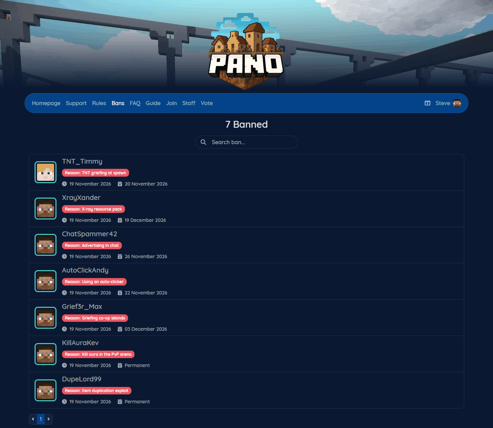
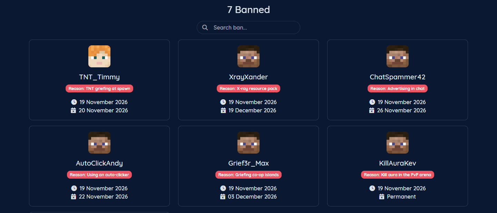
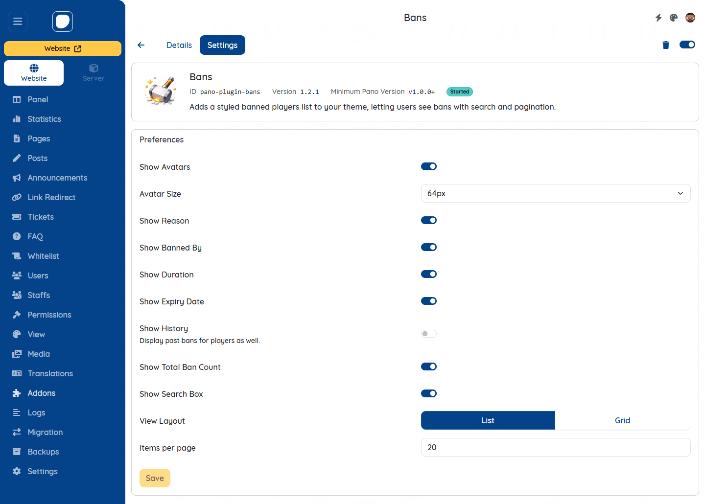

  
  <h1>Bans</h1>
  
<b>A clear, searchable ban list for your Minecraft community.</b>

  

    
    
    
  

Show your community that the rules matter. Bans adds a clean, searchable list of banned players to your website, with the reason and how long each ban lasts. Players can check a ban themselves, and your staff answer fewer questions.

<h3 align="center">Features</h3>

- 🚫 **Public ban list**: every banned player on one tidy page, linked in your site menu.
- 📝 **Ban reasons**: show why each player was banned.
- 📅 **Dates and duration**: see when a ban started and when it ends, or that it is permanent.
- 🔍 **Search**: players find a name in seconds.
- 🧑 **Player heads**: show Minecraft avatars in the size you like, or hide them.
- 🗂️ **List or grid**: pick the layout that fits your website.
- 📚 **Ban history**: optionally show past bans too, plus the total ban count.

<h3 align="center">Screenshots</h3>

<i>Prefer cards? Switch to the grid layout with one click.</i>

<i>Choose exactly what your ban page shows.</i>

<h3 align="center">Get started</h3>

1. Open your Pano panel and go to **Addons**.
2. Find **Bans** and click **Install**.
3. Ban a player from **Users** in your panel: they appear on your website's **Bans** page.

<h3 align="center">Support</h3>

Questions or ideas? Join our [Discord](https://panomc.com/discord) or visit [panomc.com](https://panomc.com).

<h3 align="center">License</h3>

Released under the MIT License.
